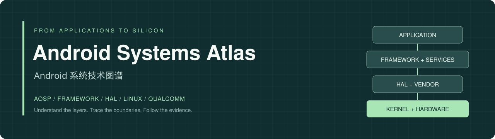
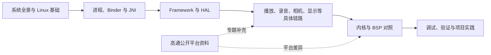

  

  <strong>从应用到芯片，建立可以追到源码的 Android 系统知识地图。</strong>

  
  
  

  <a href="#项目定位">项目定位</a> ·
  <a href="#技术地图">技术地图</a> ·
  <a href="#学习路线">学习路线</a> ·
  <a href="#高通平台专题">高通平台专题</a> ·
  <a href="#建设路线">建设路线</a> ·
  <a href="#参与贡献">参与贡献</a>

> **当前阶段：项目规划。** 仓库目前包含项目介绍与首页视觉资源；学习网站代码、课程和交互功能尚未提交，暂无在线演示或可运行版本。下文中的技术地图、课程结构与功能均为建设目标。

## 项目定位

**Android Systems Atlas** 是一个面向 Linux / Android 开发者的中文学习网站项目。它以 Android 系统架构为主线，连接应用开发、Framework、系统服务、HAL、Linux 内核与芯片平台知识，帮助学习者从“认识模块名称”走向“能解释调用关系、能追源码、能定位问题”。

内容重点面向系统开发与 BSP 工程，同时覆盖理解整套系统所需的应用、工具链、测试和交付知识。高通平台专题将与相应子系统关联，明确通用机制与具体厂商实现之间的边界。

### 适合谁

- 熟悉 Linux，希望系统理解 Android 用户态与内核协作的开发者。
- 从应用开发进入 Framework、系统服务或性能分析的工程师。
- 从事 HAL、驱动、BSP 适配与设备交付，需要补全上层调用关系的工程师。
- 希望结合公开资料学习 Qualcomm 平台软件栈的开发者。

### 学习时始终回答三个问题

| 观察角度 | 核心问题 | 需要记录的内容 |
| --- | --- | --- |
| 职责 | 这个模块负责什么？ | 输入、输出、策略与资源管理职责 |
| 进程 | 这段代码在哪里运行？ | App、system_server、原生服务、HAL 进程或内核 |
| 边界 | 它如何与下一站协作？ | 本地调用、JNI、Binder、共享缓冲区、系统调用或硬件接口 |

分层图用于表达职责，具体调用链还需要标注进程、控制流、数据流与适用场景。

## 技术地图

以下为计划覆盖的知识领域，课程将按前置知识与实际工程场景逐步展开。

| 领域 | 计划覆盖的主题 |
| --- | --- |
| **基础与全景** | Android / AOSP、系统分层、进程与线程、用户态与内核态、源码组织、版本与兼容边界 |
| **应用与运行时** | 应用组件、生命周期、Context、资源、权限、Jetpack / Compose、ART、DEX、GC、JNI、NDK |
| **Framework 与系统服务** | Binder / AIDL、ServiceManager、Zygote、system_server、应用与任务管理、窗口管理、包管理、输入系统 |
| **HAL 与系统边界** | Stable AIDL、历史 HIDL / 传统 HAL、Treble、VINTF、system / vendor、HAL 生命周期与兼容性 |
| **多媒体与图形** | AudioTrack / AudioRecord、AudioFlinger、AudioPolicy、Camera2 / Camera HAL、BufferQueue / BLAST、SurfaceFlinger、HWC、MediaCodec |
| **连接与外设** | Wi-Fi、Bluetooth、Telephony、网络管理、USB、GNSS、Sensors、NFC、设备事件与路由 |
| **内核与 BSP** | ACK / GKI / KMI、设备树、驱动模型、ALSA / ASoC、显示与相机驱动、DMA-BUF、调度、内存、电源与热管理 |
| **安全与存储** | 应用沙箱、SELinux、Verified Boot、Keystore、TEE、文件系统、加密、存储访问与权限 |
| **构建与交付** | Repo、Soong、产品配置、分区与镜像、系统启动、OTA、Mainline / APEX、CTS / VTS、版本迁移 |
| **调试与性能** | adb、logcat、dumpsys、Perfetto、ANR / native crash、内存与功耗分析、端到端问题定位 |
| **设备形态与平台专题** | Android Automotive、TV、嵌入式设备，以及高通平台的公开软件接口与工程资料 |

**覆盖范围会持续扩展。** 本项目以技术地图组织学习，不承诺穷尽所有 Android API、历史版本或厂商私有实现。

## 学习路线

建议围绕一个具体问题逐步深入，例如：

- 一次振动请求如何从应用到达硬件？
- 一段 PCM 如何播放到扬声器，又如何从麦克风进入应用？
- 相机控制命令和图像缓冲区分别怎样流转？
- 一帧画面如何经过应用、合成服务和显示链路？
- 一个触摸事件如何从驱动到达目标窗口？

### 每个专题的目标结构

| 内容 | 学习产出 |
| --- | --- |
| 场景与前置知识 | 知道这个专题解决什么问题，以及需要先学什么 |
| 架构图与调用链 | 能区分职责、进程、通信机制及控制 / 数据流 |
| 关键机制与源码入口 | 能沿着真实类、接口和实现继续阅读 |
| Android 与厂商差异 | 能判断哪些结论通用、哪些需要目标版本或 BSP 证据 |
| 观察实验与自测 | 能用明确的观察结果检验理解 |
| 来源与适用范围 | 能回到原始资料，核对版本、条件与限制 |

## 高通平台专题

高通内容将作为 Android 通用知识的扩展，并与音频、相机、图形、AI、内核和电源等主题交叉关联。

| 方向 | 计划研究的内容 | 资料边界 |
| --- | --- | --- |
| 平台与软件组成 | Snapdragon / Dragonwing 产品资料、Android 与 Qualcomm Linux 软件资料的适用范围 | 不把某款产品或 Linux 文档直接当成所有 Android BSP 的实现 |
| 异构计算 | Hexagon、FastRPC、公开 AI SDK 与运行时资料 | 核对目标芯片、操作系统、SDK 版本及支持条件 |
| 图形与多媒体 | Adreno，以及公开的音频、相机和显示资料 | 平台内部拓扑与私有接口以目标 BSP 的授权资料为准 |
| 系统集成 | 公开驱动、固件协作、设备适配、调试与性能资料 | 区分公开接口、示例实现和设备实测结果 |

需要登录、授权或具体 BSP 才能确认的内容，将明确标注其访问条件或待验证状态。仓库不收录未经授权的专有源码、固件或受限文档。

## 内容与证据原则

1. **来源可追溯**：优先引用 Android / AOSP、Linux 内核和 Qualcomm 官方文档、官方源码。
2. **版本有范围**：标注适用 Android 版本、源码分支 / revision、平台及必要条件；浮动主线不等同固定发布版本。
3. **图示有语义**：说明箭头代表调用、数据传输还是依赖关系，标明教学简化。
4. **厂商差异有边界**：通用架构、公开参考实现和量产设备实际行为分别表述。
5. **验证不夸大**：文档核对、源码静态分析、页面测试和设备验证分别记录。
6. **发现问题可修订**：事实更正附依据，保留必要的版本说明和修订记录。

## 建设路线

- [x] 创建项目仓库，建立项目定位与技术地图。
- [ ] 建立独立的网站工程与基础阅读界面。
- [ ] 整理基础架构课程与可交互调用链。
- [ ] 展开音频、相机、图形、输入等系统专题。
- [ ] 建立高通公开资料索引及平台专题。
- [ ] 增加搜索、学习进度、收藏、笔记与自测。
- [ ] 完成内容准确度审查、浏览器验证与运行说明。

当前无安装步骤。网站工程提交后，将补充依赖要求、本地运行、构建与验证命令。

## 官方资料入口

| 来源 | 用途 |
| --- | --- |
| [AOSP Architecture](https://source.android.com/docs/core/architecture) | 系统架构与平台机制 |
| [Android Developers](https://developer.android.com/) | 应用开发、API 与开发工具 |
| [Android Code Search](https://cs.android.com/) | 官方源码检索 |
| [Linux Kernel Documentation](https://docs.kernel.org/) | 内核机制、子系统与驱动文档 |
| [Qualcomm Developer](https://www.qualcomm.com/developer) | 高通开发者资源与公开技术文章 |
| [Qualcomm Documentation](https://docs.qualcomm.com/) | 高通产品与软件文档，部分内容有访问条件 |

## 参与贡献

欢迎通过 Issue 或 Pull Request 提交内容纠错、课程建议、图示改进和公开资料补充。提交技术纠错时，请尽量包含：

- 涉及的页面、段落或图中节点。
- 适用的 Android 版本、源码 revision 或设备平台。
- 问题说明与可核查的一手来源。
- 若提供实验结果，注明实验环境与验证范围。

提交代码或资源前，请确认不包含凭证、个人数据或未经授权的厂商材料。具体开发约定将在网站工程建立后补充。

## 许可与归属

本仓库尚未选定开源许可证。引用的外部资料、源码与商标归原权利人所有，使用时遵循其各自许可条款。

本项目为独立学习项目，与 Google、Android 或 Qualcomm 不存在官方隶属或背书关系。
