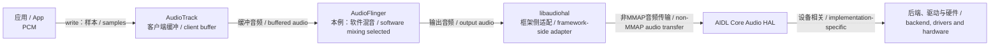
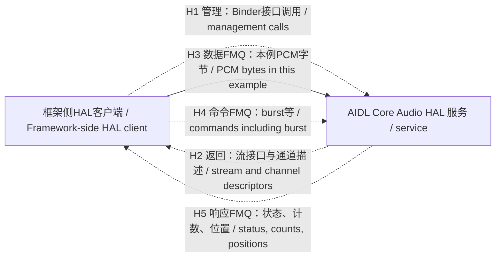

# 一段PCM如何播放 / Following PCM playback

状态：已按用户修正接入横纵一体的连续架构图，替代此前分离的播放全景/HAL箭头卡片。项目基线为Android17；HAL通道已用17固定标签关键片段复核，见[源码复核](../AUDIO-SOURCE-VERIFICATION.md)。这不等于完整音频调用链已审计。[基线与缺口](../CONTENT-BASELINE.md) · [来源编号](../SOURCE-REGISTER.md)

Status: a connected two-dimensional architecture map replaces the earlier separate playback and HAL card views. Android 17 tagged interface and transport fragments have been checked; a full audio call-chain audit remains outside this result.

## 当前首图 / Current connected map

[英文图稿](../diagrams/audio-connected.en.svg)。浏览器实际截图保留在本地：`output/playwright/audio-review-upper.png`，不纳入Git。

纵向区分应用、系统音频、HAL与设备边界；横向展示客户端调用、输出/路由策略、混音与适配协作。队列位于跨进程通信带，单独连接数据、命令和响应。此图为教学组件关系图，不是完整进程清单；所有共享缓冲和厂商细节仍受文末证据边界约束。

下文Mermaid图保留为概念拆解说明，不代表当前网页布局。网页直接使用原创SVG结构，节点与连线均可选择；正文术语使用非模态悬浮短释义，完整词典仍可打开。

The vertical bands separate responsibilities and execution boundaries; horizontal connections show collaboration. Queues occupy a communication band, not a new processing layer. The Mermaid sketches below explain individual concepts; the webpage uses the connected SVG map above.

## 先限定场景 / Select the scenario

本例应用已经拥有PCM，通过AudioTrack的MODE_STREAM持续写入，并选择普通软件混音、非MMAP的AIDL HAL输出；下半图选用ALSA非mmap写入及直接DMA/I²S设备路径。不是MP3文件解码过程，也不代表所有AudioTrack播放都会进入同一种输出路径。控制状态和数据消费存在缓冲与调度，不把一次write等同一次发声。[A01、A02、A03]

The app already has PCM and feeds an AudioTrack in MODE_STREAM. This example selects ordinary software mixing and a non-MMAP AIDL HAL output. It does not cover decoding a compressed file or every possible AudioTrack output route. Buffered writes and audible rendering are different events.

## 完整图要分两种尺度 / Two levels of detail

第一层读图只看“谁提供样本、谁混音、谁适配硬件”。第二层展开HAL通信：管理调用、命令队列、数据队列、响应队列。两层之间的节点保持同名；不能让初学者误以为应用直接操作HAL队列。

Start with sample production, mixing and hardware adaptation. Then expand the HAL boundary into management calls and separate command, data and reply queues. The framework-side HAL client is not the application.

### 数据主路径 / Main data path

本图是职责和数据流概览，未承诺客户端共享缓冲的具体结构、线程数量、复制次数或驱动调用。AudioFlinger混音依据A05，AIDL适配依据A03；客户端缓冲的精确实现待固定17标签复核。FastMixer有条件启用，不作为所有播放必经的额外节点。[A01、A03、A04、A05]

This overview does not prescribe buffer internals, thread counts, copy counts or driver calls. FastMixer is conditional, not an obligatory extra stage for all playback. Exact client-buffer implementation remains part of the tagged Android 17 review.

### HAL通信图 / HAL transport view

**证据范围 / Evidence scope：**S03–S05为Android17固定标签关键定义与实现片段，已经独立调研及主代理交叉核对；不包含完整状态机或设备实测。

图表达三种不同的FMQ用途。因此“控制全走Binder，数据全走FMQ”也过于简化。FMQ不是声音编码；数据通道在本例承载PCM，不代表其他模式也总是PCM。响应里的消费量不能简单等同扬声器已经播放的样本数。不据此宣称端到端零拷贝。

The diagram distinguishes three FMQ roles. “All control uses Binder” is too broad: stream commands also use a queue. FMQ is a transport mechanism, not an audio encoding. Consumption counts are not automatically speaker-rendered counts; the diagram makes no end-to-end zero-copy claim.

## 连线与实现约束 / Edge contract

| ID | 方向与载荷 / Direction and payload | 机制 / Mechanism | 依据与发布条件 / Evidence and gate |
|---|---|---|---|
| H1 | 框架→HAL：开流及配置 / framework→HAL: stream setup and configuration | AIDL/Binder | A03、A06；17开流返回已核对 |
| H2 | HAL→框架：接口及描述符 / HAL→framework: interfaces and descriptors | 开流返回 / setup result | S05开流返回定义已复核，不把句柄画成PCM |
| H3 | 框架→HAL：音频字节 / framework→HAL: audio bytes | 数据FMQ / data FMQ | S03、S04；非MMAP条件；17关键片段已复核 |
| H4 | 框架→HAL：流命令 / framework→HAL: stream commands | 命令FMQ / command FMQ | S03、S04；不能宣称所有控制都走Binder |
| H5 | HAL→框架：状态与实际消费量 / HAL→framework: status and consumed count | 响应FMQ / reply FMQ | S03、S04；17关键片段已复核，不代表实际扬声器出声 |

## 动画脚本 / Storyboard

教学顺序不是完整函数时序，以下步骤不提供毫秒级耗时，也不声称单次API调用同步跑完整条链。

This is a teaching sequence, not a complete call trace or a latency measurement.

| 步骤 / Step | 中文提示 | English caption | 高亮与边界 |
|---|---|---|---|
| 1 | 先建立播放对象与输出条件 | Set up the track and output conditions | 控制视图；不画PCM移动 |
| 2 | 写入的是PCM样本，不是播放命令 | Write PCM samples, not playback commands | 应用→AudioTrack；突出缓冲 |
| 3 | 播放请求改变状态，数据按缓冲节奏消费 | Playback changes state; buffered data is consumed over time | 请求与数据分色分线，允许先预填缓冲 |
| 4 | 本例由系统软件混音路径处理 | This example uses software mixing | AudioFlinger；不硬编码FastMixer、采样率或效果链 |
| 5 | 展开HAL边界，区分管理、命令、音频与响应 | Expand the HAL boundary into management, commands, audio and replies | H1–H5；17关键片段已复核并接入页面 |
| 6 | 输出到设备，具体后端因产品而异 | Send output to the device-specific backend | HAL→后端；不补造DSP或总线细节 |

完整静态图为默认。提供控制/数据/合看、播放、暂停、前一步、后一步、重播；暂停保留高亮与解释。节点和边可键盘选择。减少动态效果时以离散高亮替代移动粒子。切换语言保留步骤，切换路径重置步骤并明确说明。音频播放按钮只演示流程，不自动播放声音。

Default to the full static diagram. Offer control/data/combined views and play, pause, previous, next and replay. Pause preserves the explanation. Support keyboard selection and reduced-motion highlighting. Language changes preserve the step; path changes reset it explicitly. The animation does not play audible sound.

## 差异必须分开说 / Keep differences separate

| 维度 / Dimension | 应说明的变化 / What changes | 不能推导的结论 / Do not infer |
|---|---|---|
| Android版本 / Android version | Android14起Audio HAL向AIDL演进，新增HAL API进入AIDL；迁移文档解释HIDL/AIDL并存。[A02、A06] / AIDL evolution starts with Android14; migration documentation discusses coexistence. | 不能仅凭15/16/17编号判断设备HAL类型；不是永久兼容承诺 / OS number alone does not identify the device HAL or guarantee perpetual compatibility. |
| 配置迁移 / Configuration migration | 框架通过AIDL接口获得配置；HAL内部仍可能解析XML。[A03、A06] / The framework obtains configuration through HAL interfaces; the HAL may still parse XML. | 不能说所有XML文件被删除 / Do not claim all XML files disappeared. |
| 设备形态 / Device form factor | AAOS可按音区、乘员、用途组织路由与音量；是否启用依配置。[D01、D02] / AAOS can organize routing and volume by zones, occupants and usage. | 不能说所有车都有多音区，也不能把区域数画成固定值 / Do not assign every vehicle multiple zones or a fixed zone count. |
| 车辆专用控制 / Vehicle-specific control | AudioControl HAL与Core Audio HAL职责不同；前者处理车辆控制相关能力。[D03] / AudioControl HAL has vehicle-control duties distinct from Core Audio HAL. | 不让PCM主路径穿过AudioControl HAL / Do not insert AudioControl HAL into the ordinary PCM data path. |
| 高通与其他厂商 / Qualcomm and other vendors | 本批尚无具体Android BSP证据 / No specific Android BSP evidence in this batch. | 不补造PAL、DSP、驱动或总线的必经链路 / Do not invent mandatory vendor components or buses. |

平板、折叠屏、电视、手表的音频差异本批尚未逐一核实；没有材料不等于完全相同。进一步拆分低延迟、压缩卸载、蓝牙、录音和通话，各自核验后再增加图和选择项。

Tablet, foldable, TV and watch audio differences have not been individually verified in this batch. Lack of evidence is not evidence of identical behavior. Low-latency, offload, Bluetooth, recording and call paths require separate verification before adding selectable diagrams.

## 配套术语 / Companion terminology

| 词 / Term | 类型 / Type | 初学者解释 / Beginner explanation |
|---|---|---|
| PCM | 数据表示 / Data representation | 以采样值表示音频；不是传输协议 / Sample values representing audio, not a transport protocol. |
| AudioTrack | 应用播放API及相关客户端 / Playback API and associated client | 接受应用音频数据；不是硬件扬声器 / Accepts application audio, not a physical speaker. |
| AudioFlinger | 原生音频服务组件 / Native audio service component | 本例负责软件播放处理与混音 / Provides software playback processing and mixing in this example. |
| AIDL | 接口描述语言 / Interface definition language | 描述服务接口；不是数据编码或进程名 / Describes interfaces, not audio encoding or a process name. |
| Binder | IPC机制 / IPC mechanism | 支持跨进程调用；不代表所有音频字节的路径 / Supports IPC, not necessarily the sample-data path. |
| JNI | 语言接口 / Language interface | 连接Java/Kotlin与C/C++；不意味着跨进程 / Bridges managed and native code, not inherently IPC. |
| FMQ | 队列通信机制 / Queue-based communication | 区分命令、响应和数据队列 / Distinguish command, reply and data queues. |
| AudioControl HAL | AAOS控制接口 / AAOS control interface | 车辆控制职责；区别于Core Audio HAL的音频流职责 / Vehicle controls, distinct from Core Audio HAL streaming. |

来源：A01–A06、F02–F04、D03；FMQ细分依据S03已复核。术语卡必须同时展示“它是什么”和“不要与什么混淆”，无需添加练习。

## 后续深挖与验证边界 / Further work and validation boundaries

- 获取并核对Android17下启动注册、客户端共享缓冲、HAL流协议与适配实现；补齐精确进程图及返回边。
- H1–H5已以Android17标签关键片段复核，后续完整状态机和异常分支单独展开。
- 本设计已接入现有页面；本批浏览器验证结果见 [预览说明](../PREVIEW.md)。
- 明确每个差异选项的版本与条件；无证据的组合不生成比较结果。
- 设备未测试则保留“文档/源码核验，未实测”说明。

Verify the Android 17 process, buffer and HAL implementation; integrate the design; then validate bilingual rendering, accessibility, mobile layout and playback controls. Keep unverified combinations unavailable and retain the no-device-testing boundary.
