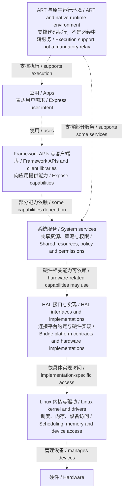
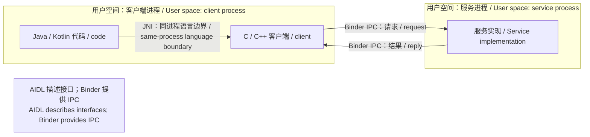
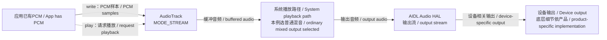

# 先看懂三种图 / Three views of Android

状态：双语内容与原创图稿已接入首页，音频场景链接至交互页。版本见[内容基线](../CONTENT-BASELINE.md)，编号见[来源登记](../SOURCE-REGISTER.md)。职责图是抽象分组；进程图是执行位置；场景图才描述一次具体操作。三者不能互相替代。

These views answer different questions: responsibility, execution location, and a selected operation. A layer is not automatically a process, and vertical placement does not imply a mandatory call sequence.

## 1. 职责：每部分解决什么问题？ / Responsibilities

虚线表示职责依赖，不表示PCM、Binder事务或严格时序。本图选择常见关系，未列出全部依赖。HAL也不是所有系统服务的下游；例如纯软件工作无需访问设备。[F01、F05、A04]

Dashed arrows represent selected responsibility dependencies, not packets or a strict sequence. Software-only operations need not reach a HAL or a device. ART supports execution; it is not an extra server inserted between every pair of layers.

交互设计：点节点显示“职责、常见组件、不是啥”；本图不播放数据流粒子。点击“看执行位置”进入图2，保留所选组件。

Interaction: select a node for its role, examples and common misconceptions. No data-flow animation in this view. Switch to the execution view while retaining selection.

## 2. 执行位置：哪里需要跨进程？ / Execution boundaries

这是接口与进程边界的最小示例，不是Android17全部进程清单，也不表示所有Java调用都必须经过JNI。Java也可使用生成的Binder绑定；这里刻意只选择一条客户端路径。内核参与Binder传输，但图中省略内核内部机制。[F02、F03、F04]

This minimal example separates a language boundary from a process boundary. It is not an Android 17 process inventory. Java can use generated Binder bindings directly; JNI is not required for every IPC. Binder's kernel-side transport is omitted here.

交互设计：悬停边直接显示“方向、载荷、通信机制、是否跨进程”。进程背景框始终显示。后续音频精确进程视图须补齐固定标签的启动与注册证据，再填入具体进程名，不能依据旧mediaserver概述推断。[A04]

Interaction: each edge explains direction, payload, mechanism and boundary crossing. Keep process containers visible. Populate the detailed audio process view only after verifying startup and registration in the pinned source.

## 3. 场景：一段PCM怎样进入播放链？ / A playback scenario

这是音频样板的入口视图，隐藏通信实现而保留载荷含义。实线是音频数据，虚线是操作请求；完整控制路径、缓冲边界和返回状态见[音频样板](AUDIO-PLAYBACK.md)。样本写入成功不等于已经从扬声器发声。[A01、A02、A03]

This overview preserves payload meaning while hiding transport details. Solid arrows carry audio; the dashed arrow represents a playback request. Successful writes are not proof that those samples have already been rendered.

图只描述选定场景，不把AudioTrack所有模式都画成普通混音。不在该图加入文件解码、蓝牙、通话或DSP，因为它们需要各自的前提和证据。

The diagram covers the selected scenario, not every AudioTrack mode. File decoding, Bluetooth, calls and DSP processing need separate paths and evidence.

## 三图共同的呈现规则 / Shared presentation rules

- 中英切换替换文字，不改变事实、图结构或当前选择。English mode preserves structure and selection.
- 节点详情与来源可键盘访问，不依赖仅悬停。Details and sources must be keyboard accessible.
- 箭头始终有方向与文字，不只靠颜色。Arrows retain direction and text labels.
- 图1不动画；图2可逐步高亮边界；图3进入音频章节后演示，播放节奏不代表真实耗时。Animation is explanatory, never a timing measurement.
- 网页接入前需验证手机可读性、放大、减少动态效果设置和两种语言；本批文档不替代这些验收。Browser and accessibility validation remain implementation work.
